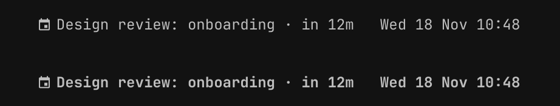

Set the bar's date, time and event in semibold, set any switch from a terminal, and get a round of safety and privacy fixes for links, reminders and live sync.


## New

- **Bold in the bar.** Turn on **Bold in the bar** in Calendar for Omarchy's settings, or set `barBold` to `true`, and the date, time and event in the bar are set in semibold. The label keeps the stock clock's size, centering and press feedback. By @crmne.



## Fixed

- **Links say where they go, and links that hide their host are dropped.** A link like `https://meet.google.com@evil.example/` opens evil.example, and Calendar for Omarchy used to let it through. A link with a username in it is now no link at all. Hovering **Join** or **Open in HEY** names the host, and so does a reminder with a meeting link. By @crmne, from [#17](https://github.com/crmne/omarchy-calendar/pull/17) by @robsquared82.
- **Reminders show their text as written, and stay out of shared folders.** A place such as `AT&T <HQ>` could be read as markup by a notification daemon. Without `XDG_RUNTIME_DIR`, reminders were written under `/tmp`, where another user could get there first; they are now skipped instead. By @crmne, from [#15](https://github.com/crmne/omarchy-calendar/pull/15) by @robsquared82.
- **Less of your calendar is written to disk or handed to the shell.** Fetching a HEY week no longer writes notes, guests and journal text to a temporary file, only what the calendar shows, and live sync passes the shell only the kind of each change in HEY, not the whole event. By @crmne, from [#14](https://github.com/crmne/omarchy-calendar/pull/14) and [#13](https://github.com/crmne/omarchy-calendar/pull/13) by @robsquared82.
- **Switches set from a terminal work.** `omarchy bar set crmne.omacal barBold true` stores the text "true", which every switch read as off, and "false" could not turn off a switch that is on by default. Both spellings now work for every switch. By @crmne.

## Known limitations

- **Bold is for horizontal bars.** On a vertical bar the label keeps its normal weight.

## Install

```sh
omarchy plugin add https://github.com/crmne/omarchy-calendar.git --enable
omarchy plugin disable omarchy.clock
```

Already installed: `omarchy plugin update crmne.omacal`.

## Thanks

@crmne implemented the changes. Thanks to @robsquared82 for the security and privacy review and the pull requests behind three of these fixes.

Calendar for Omarchy is an independent project, not created by, affiliated with, or supported by HEY, 37signals or Google.

**Full changelog**: https://github.com/crmne/omarchy-calendar/compare/v1.2.1...v1.3.0
